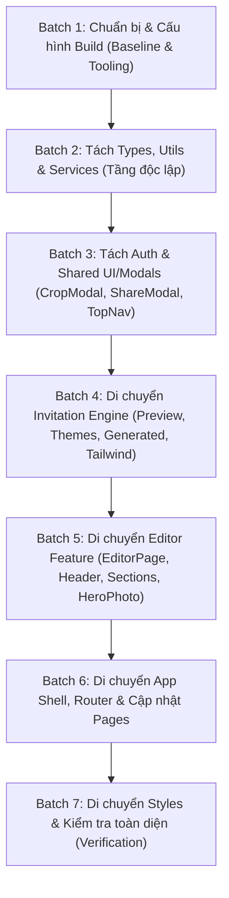

# KẾ HOẠCH DI CHUYỂN & TÁI CẤU TRÚC MÃ NGUỒN (REACTJS FILE MIGRATION PLAN)

**Dự án:** Chung Đôi Editor & Web (`chungdoi-editor`)  
**Mục tiêu:** Di chuyển và chuẩn hóa cấu trúc thư mục mà không gây phá vỡ tính năng (Zero Regression).  
**Quy tắc bất biến:** Không sửa đổi mã nguồn ứng dụng trước khi kế hoạch này được phê duyệt.

---

## 1. BẢNG KẾ HOẠCH DI CHUYỂN TẬP TIN CHI TIẾT (FILE MIGRATION MATRIX)

| # | Current Path | Target Path | Lý do di chuyển (Reason) | Các import cần cập nhật (Required Import Updates) | Mức độ rủi ro (Risk) |
|---|---|---|---|---|---|
| 1 | `src/types.ts` (mới) / `src/data.ts` | `src/types/invitation.ts` | Tách định nghĩa kiểu TypeScript thuần túy (`Inv`, `GiftMethod`, `Ceremony`, `TimelineEvent`, `Wish`) ra khỏi dữ liệu mẫu và calendar utilities | Cập nhật `App.tsx`, `Preview.tsx`, `Sections.tsx`, `HeroPhoto.tsx`, `PublishCheckModal.tsx`, `Demo.tsx`, `store.ts` | Thấp (Chỉ đổi import type) |
| 2 | `src/data.ts` (phần utils) | `src/utils/date.ts` | Tách các hàm tính ngày tháng & lịch (`WEEKDAYS_FULL`, `WEEKDAYS_SHORT`, `parseDate`, `monthGrid`, `formatTime`, `buildIcs`) | Cập nhật `Preview.tsx` | Thấp (Pure functions) |
| 3 | `src/data.ts` (phần format) | `src/utils/format.ts` | Tách helper format tên dâu rể (`groomShown`, `brideShown`) | Cập nhật `Preview.tsx`, `Sections.tsx` | Thấp (Pure functions) |
| 4 | `src/data.ts` (phần mock) | `src/features/editor/data/defaultData.ts` | Giữ `defaultInv` và `blankInv` gọn gàng trong module editor | Cập nhật `App.tsx`, `Demo.tsx` | Thấp |
| 5 | `src/store.ts` (phần types) | `src/types/card.ts`, `src/types/guest.ts` | Tách type `Card` và `Guest` ra tầng types | Cập nhật `store.ts`, `Dashboard.tsx`, `Guests.tsx`, `PublishCheckModal.tsx` | Thấp |
| 6 | `src/store.ts` | `src/services/storage/store.ts` | Đưa tầng persistence LocalStorage vào đúng layer `services/storage/` | Cập nhật `App.tsx`, `Dashboard.tsx`, `Guests.tsx`, `Account.tsx`, `TemplateModal.tsx`, `Demo.tsx` | Thấp |
| 7 | `src/theme.ts` | `src/app/theme.ts` | Đưa quản lý theme toàn cục vào tầng `app/` | Cập nhật `main.tsx`, `TopNav.tsx` | Thấp |
| 8 | `src/router.tsx` | `src/app/router.tsx` | Đưa custom router vào tầng `app/` | Cập nhật `Root.tsx`, `TopNav.tsx`, `TemplateModal.tsx`, `Dashboard.tsx`, `Guests.tsx`, `Demo.tsx`, `Pricing.tsx`, `Templates.tsx`, `Home.tsx` | Trung bình (Dùng rộng rãi ở mọi trang) |
| 9 | `src/TopNav.tsx` (phần auth) | `src/features/auth/hooks/useAuth.ts` | Tách `useAuth()` và `AUTH_KEY` khỏi UI Navbar | Cập nhật `TopNav.tsx`, `Dashboard.tsx`, `Guests.tsx` | Trung bình (Cần kiểm tra event `auth_change`) |
| 10 | `src/TopNav.tsx` (phần login) | `src/features/auth/components/LoginModal.tsx` | Tách `LoginModal` thành component độc lập | Cập nhật `TopNav.tsx`, `Dashboard.tsx`, `Guests.tsx`, `Templates.tsx` | Trung bình |
| 11 | `src/TopNav.tsx` (phần Logo) | `src/components/layout/Logo.tsx` | Tách `Logo` để tái sử dụng ở `Root.tsx` (Footer) và `TopNav.tsx` | Cập nhật `Root.tsx`, `TopNav.tsx` | Thấp |
| 12 | `src/TopNav.tsx` | `src/components/layout/TopNav.tsx` | Đưa Navigation bar vào `components/layout/` | Cập nhật `Root.tsx`, `App.tsx` | Thấp |
| 13 | `src/ui.tsx` | `src/components/ui/ui.tsx` | Đưa UI primitives (`Icon`, `Toggle`, `Input`, `Section`...) vào `components/ui/` | Cập nhật `Header.tsx`, `HeroPhoto.tsx`, `Sections.tsx` | Thấp |
| 14 | `src/HeroPhoto.tsx` (phần CropModal) | `src/components/common/CropModal.tsx` | Tách modal cắt ảnh ra component dùng chung | Cập nhật `HeroPhoto.tsx`, `Sections.tsx` | Trung bình (Crop modal dùng ở cả Hero và Sections) |
| 15 | `src/ShareModal.tsx` | `src/components/common/ShareModal.tsx` | Đưa modal chia sẻ & QrModal vào `components/common/` | Cập nhật `App.tsx`, `Dashboard.tsx` | Thấp |
| 16 | `src/templates.ts` | `src/features/templates/data/templates.ts` | Đưa danh mục template vào feature `templates` | Cập nhật `Header.tsx`, `TemplateModal.tsx`, `Preview.tsx`, `Sections.tsx`, `Templates.tsx`, `Demo.tsx`, `store.ts` | Trung bình (Dùng ở nhiều nơi) |
| 17 | `src/templateThemes.ts` | `src/features/invitation/config/templateThemes.ts` | Đưa bảng màu template vào feature `invitation` | Cập nhật `Preview.tsx` | Thấp |
| 18 | `src/TemplateModal.tsx` | `src/features/templates/components/TemplateModal.tsx` | Đưa modal chi tiết mẫu thiệp vào feature `templates` | Cập nhật `Templates.tsx` | Thấp |
| 19 | `src/generated/` (cả thư mục) | `src/features/invitation/components/generated/` | Đưa toàn bộ headers sinh tự động vào feature `invitation` | Cập nhật `Preview.tsx`, `main.tsx`, `scripts/gen_headers.py`, `tailwind.config.js` | **CAO** (Phải cập nhật cả cấu hình Tailwind và script Python) |
| 20 | `src/LongPhungV2.tsx` | `src/features/invitation/components/LongPhungV2.tsx` | Đưa template cover Long Phụng vào feature `invitation` | Cập nhật `Preview.tsx`, `tailwind.config.js` | Trung bình (Ảnh hưởng Tailwind scan) |
| 21 | `src/MinimalismDarkRed.tsx` | `src/features/invitation/components/MinimalismDarkRed.tsx` | Đưa template cover Minimalism vào feature `invitation` | Cập nhật `Preview.tsx`, `tailwind.config.js` | Trung bình (Ảnh hưởng Tailwind scan) |
| 22 | `src/Preview.tsx` | `src/features/invitation/components/Preview.tsx` | Đưa engine Preview vào feature `invitation` | Cập nhật `App.tsx`, `Demo.tsx`, `tailwind.config.js` | **CAO** (Trái tim của tính năng xem thiệp) |
| 23 | `src/Header.tsx` | `src/features/editor/components/Header.tsx` | Đưa Header của Editor vào feature `editor` | Cập nhật `App.tsx` | Thấp |
| 24 | `src/HeroPhoto.tsx` | `src/features/editor/components/HeroPhoto.tsx` | Đưa Section ảnh đầu trang vào feature `editor` | Cập nhật `App.tsx` | Thấp |
| 25 | `src/MusicPicker.tsx` | `src/features/editor/components/MusicPicker.tsx` | Đưa modal chọn nhạc vào feature `editor` | Cập nhật `Sections.tsx` | Thấp |
| 26 | `src/PublishCheckModal.tsx` | `src/features/editor/components/PublishCheckModal.tsx` | Đưa modal kiểm tra xuất bản vào feature `editor` | Cập nhật `App.tsx` | Thấp |
| 27 | `src/TutorialTour.tsx` | `src/features/editor/components/TutorialTour.tsx` | Đưa Onboarding tour vào feature `editor` | Cập nhật `App.tsx` | Thấp |
| 28 | `src/Sections.tsx` (phần banks) | `src/features/editor/constants/banks.ts` | Tách mảng hằng số `VN_BANKS` ra tệp riêng | Cập nhật `Sections.tsx` | Thấp |
| 29 | `src/Sections.tsx` | `src/features/editor/components/Sections.tsx` | Đưa khối sections soạn thảo vào feature `editor` | Cập nhật `App.tsx` | Trung bình (File lớn, giữ nguyên logic 16 sections) |
| 30 | `src/App.tsx` | `src/features/editor/EditorPage.tsx` | Đổi tên cho đúng bản chất là trang Editor | Cập nhật `Root.tsx` | Trung bình |
| 31 | `src/Root.tsx` | `src/app/Root.tsx` | Đưa Root router/shell vào tầng `app/` | Cập nhật `main.tsx` | Thấp |
| 32 | `src/pages/*` | `src/pages/*` | Giữ nguyên vị trí thư mục `pages/`, chỉ cập nhật lại các import hướng tới các module mới | Cập nhật import trong 7 trang | Trung bình |
| 33 | `src/styles.css`, `pages.css`, `tw.css` | `src/styles/` | Tập trung toàn bộ stylesheets vào thư mục `styles/` | Cập nhật `main.tsx` | Thấp |
| 34 | `src/main.tsx` | `src/main.tsx` | Giữ nguyên tại gốc `src/main.tsx`, cập nhật import Root, Theme, CSS | Entry point | Thấp |

---

## 2. PHÂN LOẠI CÁC NHÓM HÀNH ĐỘNG (ACTION CATEGORIZATION)

### 2.1. Safe File Moves (Di chuyển nguyên vẹn, ít phụ thuộc)
- Di chuyển styles: `styles.css`, `pages.css`, `tw.css` -> `src/styles/`
- Di chuyển `theme.ts` -> `src/app/theme.ts`
- Di chuyển `router.tsx` -> `src/app/router.tsx`
- Di chuyển `ui.tsx` -> `src/components/ui/ui.tsx`
- Di chuyển `ShareModal.tsx` -> `src/components/common/ShareModal.tsx`
- Di chuyển `MusicPicker.tsx`, `PublishCheckModal.tsx`, `TutorialTour.tsx` -> `src/features/editor/components/`
- Di chuyển `TemplateModal.tsx` -> `src/features/templates/components/`

### 2.2. Import & Reference Updates (Cập nhật đường dẫn import)
- Cập nhật import trong toàn bộ 7 trang (`pages/Home.tsx`, `Pricing.tsx`, `Templates.tsx`, `Dashboard.tsx`, `Guests.tsx`, `Account.tsx`, `Demo.tsx`).
- Cập nhật import trong `Root.tsx` và `main.tsx`.
- Cập nhật đường dẫn quét lớp CSS trong `tailwind.config.js`:
  ```js
  content: [
    "./src/features/invitation/**/*.{tsx,jsx}",
    "./src/features/editor/**/*.{tsx,jsx}",
    "./src/components/**/*.{tsx,jsx}",
    "./src/pages/**/*.{tsx,jsx}",
  ]
  ```
- Cập nhật đường dẫn output trong `scripts/gen_headers.py`:
  ```python
  OUT = r"D:\MY PRO\applications\MainCoupleStory\web\src\features\invitation\components\generated"
  ```

### 2.3. Component & Module Refactoring (Tách cấu trúc có kiểm soát)
1. **Tách Authentication khỏi `TopNav.tsx`:**
   - Tạo `src/features/auth/hooks/useAuth.ts` chứa `useAuth` và `AUTH_KEY`.
   - Tạo `src/features/auth/components/LoginModal.tsx` chứa `LoginModal`.
   - `TopNav.tsx`, `Dashboard.tsx`, `Guests.tsx` import từ `src/features/auth`.
2. **Tách `CropModal` khỏi `HeroPhoto.tsx`:**
   - Tạo `src/components/common/CropModal.tsx`.
   - Cả `HeroPhoto.tsx` và `Sections.tsx` cùng import từ `CropModal.tsx`.
3. **Phân tách `data.ts` thành 3 module rõ ràng:**
   - `src/types/invitation.ts` (Types: `Inv`, `GiftMethod`, `Ceremony`, `TimelineEvent`, `Wish`)
   - `src/utils/date.ts` (Calendar utils: `WEEKDAYS_FULL`, `WEEKDAYS_SHORT`, `parseDate`, `monthGrid`, `formatTime`, `buildIcs`)
   - `src/utils/format.ts` (Format utils: `groomShown`, `brideShown`)
   - `src/features/editor/data/defaultData.ts` (Mock data: `defaultInv`, `blankInv`)
4. **Tách `VN_BANKS` khỏi `Sections.tsx`:**
   - Tạo `src/features/editor/constants/banks.ts` chứa danh sách các ngân hàng Việt Nam.

### 2.4. Dead-code Removal Candidates (Ứng viên mã chết)
- Hiện tại kiểm toán không phát hiện file nào thừa hoàn toàn. Tất cả 34 file đều đang được import và tham chiếu trực tiếp bởi ứng dụng.
- **Không xóa bất kỳ file nào mà không có bằng chứng.**

### 2.5. Cải tiến tương lai ngoài phạm vi di chuyển (Out of Scope for Initial Migration)
- Tách nhỏ từng section trong `Sections.tsx` thành 16 component độc lập (`features/editor/components/sections/BasicSection.tsx` v.v.). Hiện tại giữ `Sections.tsx` nguyên khối trong `features/editor/components/Sections.tsx` để giảm thiểu tối đa rủi ro hồi quy (regression risk).
- Cấu hình Code-splitting & Lazy Loading (`React.lazy`) cho các route lớn (`Home`, `Editor`, `Preview`).
- Bổ sung kiểm thử tự động với Vitest / Testing Library.

---

## 3. LỘ TRÌNH THỰC HIỆN THEO BATCH (STEP-BY-STEP IMPLEMENTATION ROADMAP)



### Chi tiết từng Batch:

- **Batch 1: Chuẩn bị & Thiết lập Alias (tùy chọn) / Baseline Check**
  - Kiểm tra trạng thái Git sạch.
  - Chạy `npm run build` và `npm run check:assets` để xác nhận baseline xanh 100%.
  - Cấu hình alias `@/*` trong `tsconfig.json` và `vite.config.ts` để việc import sạch sẽ và bền vững khi di chuyển thư mục (hoặc dùng đường dẫn tương đối chuẩn xác).

- **Batch 2: Types, Utilities & Storage Services**
  - Tạo `src/types/invitation.ts`, `src/types/card.ts`, `src/types/guest.ts`.
  - Tạo `src/utils/date.ts`, `src/utils/format.ts`.
  - Tạo `src/services/storage/store.ts`.
  - Chạy `npm run build` để kiểm tra.

- **Batch 3: Auth Feature & Shared Components**
  - Tạo `src/features/auth/hooks/useAuth.ts`, `src/features/auth/components/LoginModal.tsx`.
  - Tạo `src/components/common/CropModal.tsx`, `src/components/common/ShareModal.tsx`.
  - Tạo `src/components/layout/Logo.tsx`, `src/components/layout/TopNav.tsx`.
  - Tạo `src/components/ui/ui.tsx`.
  - Chạy `npm run build` để kiểm tra.

- **Batch 4: Invitation & Template Engine**
  - Tạo `src/features/templates/data/templates.ts`, `src/features/templates/components/TemplateModal.tsx`.
  - Tạo `src/features/invitation/config/templateThemes.ts`.
  - Di chuyển `src/LongPhungV2.tsx`, `src/MinimalismDarkRed.tsx`, `src/Preview.tsx`, `src/generated/` -> `src/features/invitation/`.
  - Cập nhật `tailwind.config.js` và `scripts/gen_headers.py`.
  - Chạy `npm run build` để kiểm tra.

- **Batch 5: Editor Feature**
  - Tạo `src/features/editor/constants/banks.ts`.
  - Tạo `src/features/editor/data/defaultData.ts`.
  - Di chuyển `Header.tsx`, `HeroPhoto.tsx`, `MusicPicker.tsx`, `PublishCheckModal.tsx`, `TutorialTour.tsx`, `Sections.tsx` -> `src/features/editor/components/`.
  - Chuyển `App.tsx` -> `src/features/editor/EditorPage.tsx`.
  - Chạy `npm run build` để kiểm tra.

- **Batch 6: App Shell & Pages**
  - Di chuyển `theme.ts`, `router.tsx`, `Root.tsx` -> `src/app/`.
  - Cập nhật import trong toàn bộ 7 file trang thuộc `src/pages/`.
  - Chạy `npm run build` để kiểm tra.

- **Batch 7: Styles, Entry Point & Verification**
  - Di chuyển các file CSS vào `src/styles/`.
  - Cập nhật import trong `src/main.tsx`.
  - Dọn dẹp các tệp gốc đã di chuyển sau khi xác nhận bản sao mới hoạt động.
  - Chạy toàn bộ test suites, asset check và production build.
